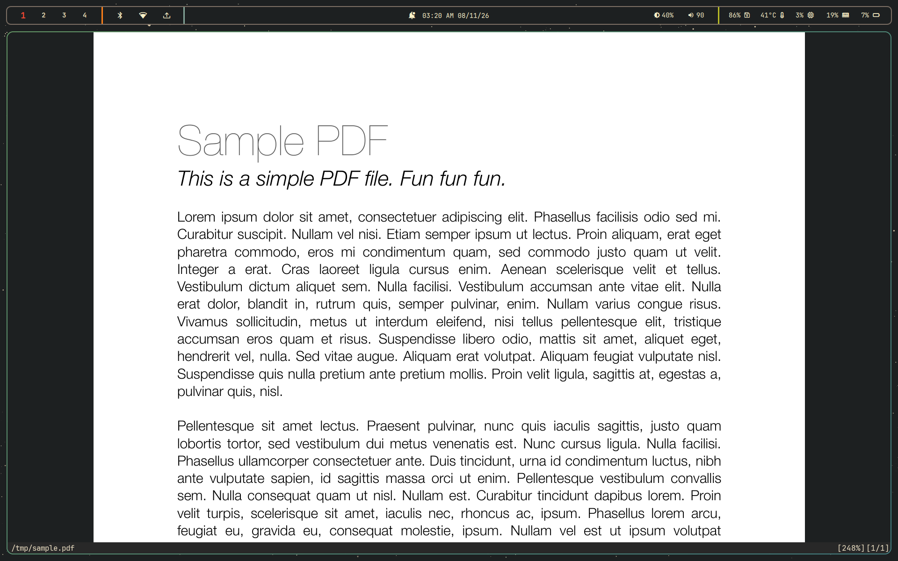
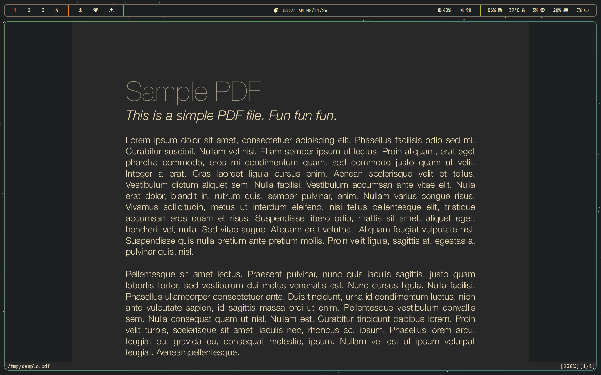
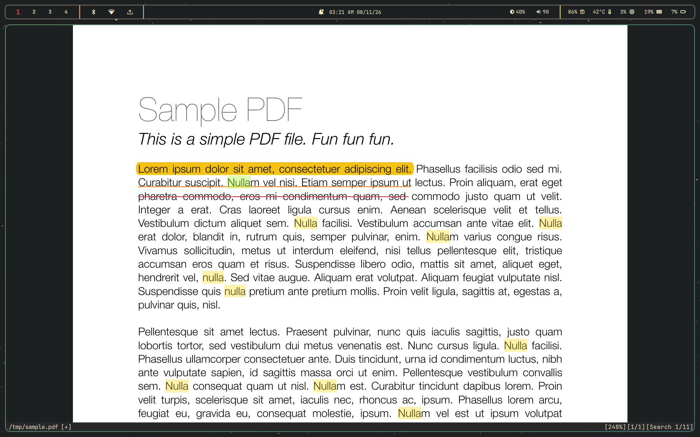
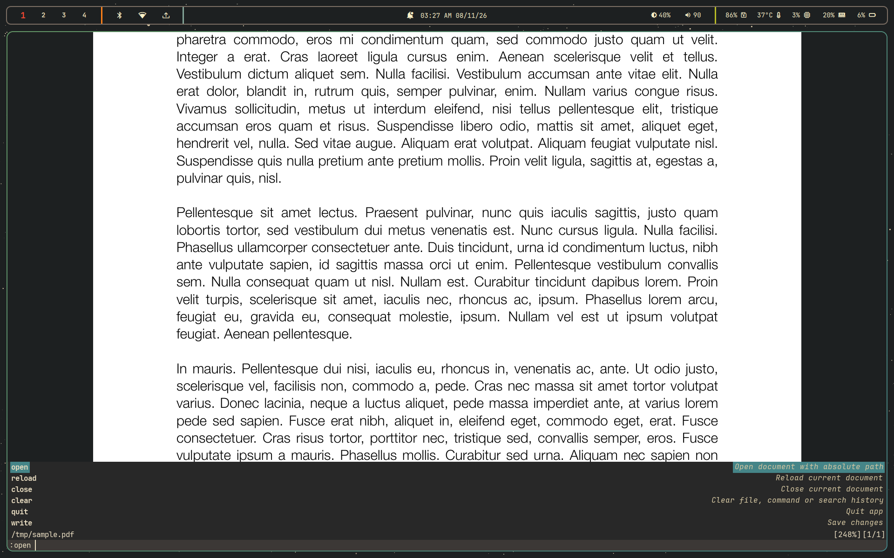

# ViPDF

A keyboard-driven PDF reader with Vim-style motions. Built on [MuPDF](https://mupdf.com/) for rendering and [SFML](https://www.sfml-dev.org/) for the GUI. Its look and feel is inspired by [Zathura](https://pwmt.org/projects/zathura/).









## Features

- **Vim-style navigation**: pan, scroll, and jump through documents without touching the mouse
- **Lightweight**: very low RAM usage, so it stays responsive even on modest hardware
- **Annotations**: highlight, underline, and strikethrough, each in five colors
- **Bookmarks**: save, delete and jump to bookmarked pages within a document
- **Fully themeable**: every UI element's color can be changed through a simple INI file
- **Custom color inversion**: recolor pages with your own light and dark colors, not just a plain invert
- **Fast**: multithreaded page rendering with a configurable page cache size

## Manual Dependencies

### Build tools

- C++23 compiler: GCC 13+ or Clang 17+
- [Meson](https://mesonbuild.com/): 0.58+, plus Ninja
- [CMake](https://cmake.org/) (needed to build `sfml`, `sdbus-cpp` and `clip` subprojects)
- `pkg-config`
- `git`

### System libraries

These must be installed with your package manager (development headers included):

- [MuPDF](https://mupdf.com/): 1.28.2+
- [FreeType2](https://freetype.org/)
- [HarfBuzz](https://harfbuzz.github.io/)
- libpng
- libxcb
- libsystemd (includes udev)
- X11, Xrandr, Xcursor, Xi
- OpenGL (Mesa or vendor driver)

### Optional Dependencies

Printing (`:print`) and opening links inside documents use D-Bus calls to the
[XDG Desktop Portal](https://flatpak.github.io/xdg-desktop-portal/) (the `Print` and `OpenURI` interfaces).
If you want these features, you need:

| Dependency                                                                 | Needed for                                   |
| -------------------------------------------------------------------------- | -------------------------------------------- |
| `xdg-desktop-portal`                                                       | `:print` and link opening                    |
| A portal backend (`xdg-desktop-portal-gtk`, `-gnome`, `-kde`, `-wlr`, ...) | Showing the print dialog and opening the URI |

A running D-Bus session bus is also required, which most desktop environments provide by default.
Without a portal, ViPDF still works normally, but `:print` and link opening will not be available.

## Installation

### 1. Install dependencies

**Fedora**

```sh
sudo dnf install -y gcc-c++ meson ninja-build cmake git pkgconf-pkg-config \
  mupdf-devel freetype-devel harfbuzz-devel libpng-devel libxcb-devel \
  systemd-devel libX11-devel libXrandr-devel libXcursor-devel libXi-devel \
  mesa-libGL-devel

# optional: :print and link opening
sudo dnf install -y xdg-desktop-portal xdg-desktop-portal-gtk
```

### 2. Build and install

```sh
git clone https://github.com/asmit-mit/ViPDF.git
cd ViPDF

meson setup build --prefix=$HOME/.local
meson compile -C build
meson install -C build --skip-subprojects
```

Make sure `~/.local/bin` is in your `PATH`.

## Usage

```sh
vipdf path/to/document.pdf
```

Press `:` to open the command line. Press `Esc` to cancel the current action and return focus to the document view.

## Keybindings

> Keybindings are currently fixed. Custom keybindings are not supported yet.

`Ctrl` and `Shift` are written explicitly. Keys separated by spaces are pressed in sequence.

### Navigation

| Key                                | Action               |
| ---------------------------------- | -------------------- |
| `h` / `l` or `←` / `→`             | Pan left / right     |
| `k` / `j` or `↑` / `↓`             | Pan up / down        |
| `u` / `d` or `PageUp` / `PageDown` | Previous / next page |
| `Ctrl+u` / `Ctrl+d`                | Half page up / down  |
| `g g`                              | Go to first page     |
| `Shift+g`                          | Go to last page      |

### View

| Key       | Action                           |
| --------- | -------------------------------- |
| `Ctrl+=`  | Zoom in                          |
| `Ctrl+-`  | Zoom out                         |
| `f`       | Fit page                         |
| `w`       | Fit width                        |
| `r`       | Rotate clockwise                 |
| `Shift+r` | Rotate counter-clockwise         |
| `i`       | Toggle recolor (color inversion) |

### Command line

| Key             | Action                            |
| --------------- | --------------------------------- |
| `Ctrl+p` or `↑` | Previous command in history       |
| `Ctrl+n` or `↓` | Next command in history           |
| `Tab`           | Open completions                  |
| `Enter`         | Run the command                   |
| `Esc`           | Cancel and return to the document |

While the completion list is open, `Tab`, `Enter` and `Esc` behave as described in [Completions](#completions) instead.

### Search and Selection

| Key             | Action                                            |
| --------------- | ------------------------------------------------- |
| `n`             | Next search result                                |
| `Shift+n`       | Previous search result                            |
| `y` or `Ctrl+c` | Copy selection (or the selected image, see below) |

To copy an image, click on it to select it, then press `y` or `Ctrl+c`.

### Annotations

| Key         | Action                                 |
| ----------- | -------------------------------------- |
| `a h 1`-`5` | Highlight selection with color 1-5     |
| `a u 1`-`5` | Underline selection with color 1-5     |
| `a s 1`-`5` | Strikethrough selection with color 1-5 |
| `a d`       | Remove annotation                      |

To remove an annotation, click on it, then press `a d`.

### General

| Key   | Action                                 |
| ----- | -------------------------------------- |
| `:`   | Open command line                      |
| `/`   | Open search                            |
| `Esc` | Cancel and return to the document view |

## Commands

Press `:` to open the command line.

| Command           | Alias | Description                                           |
| ----------------- | ----- | ----------------------------------------------------- |
| `:open <path>`    | `:o`  | Open a document                                       |
| `:reload`         |       | Reload the current document                           |
| `:close`          |       | Close the current document                            |
| `:write [path]`   | `:w`  | Save changes. Use % as path to overwrite current file |
| `:quit`           | `:q`  | Quit ViPDF                                            |
| `:clear files`    |       | Clear recent files                                    |
| `:clear search`   |       | Clear search history                                  |
| `:clear commands` |       | Clear command history                                 |
| `:print`          |       | Print the current document                            |

Arguments that contain spaces must be wrapped in double quotes, for example:

```
:write "example text.pdf"
```

### Bookmarks

| Command              | Description                         |
| -------------------- | ----------------------------------- |
| `:bmark add <name>`  | Save the current page as a bookmark |
| `:bmark del <name>`  | Delete a bookmark                   |
| `:bmark jump <name>` | Jump to a bookmark                  |

`:b` can be used in place of `:bmark`, for example `:b jump <name>`.

Bookmark names must be unique within a document.

### Completions

Press `Tab` to open completions for the current command, if it has any. Completions are available for file paths (`:open`, `:write`) and bookmark names (`:bmark del`, `:bmark jump`).

| Key                     | Action                            |
| ----------------------- | --------------------------------- |
| `Ctrl+j` or `Tab`       | Cycle down in the completion list |
| `Ctrl+k` or `Shift+Tab` | Cycle up in the completion list   |
| `Enter`                 | Select the highlighted completion |
| `Esc`                   | Close the completion list         |

## Configuration

ViPDF reads its configuration from:

```
~/.config/vipdf/config.ini
```

You only need to include the values you want to change; everything else falls back to the defaults below.

### Default configuration

```ini
; Default configuration.
; Colors: #rrggbb, or #rrggbbaa (alpha value supported only for highlights).

[app]
background = 0x1d2021

[cmdline]
background = 0x3c3836
text = 0xebdfc3
textbox_highlight = 0x7daea3
highlight_text = 0x3c3836

[completions]
background = 0x282828
left_text = 0xebdfc3
right_text = 0xd5c7a2
highlight = 0x458588

[notification]
background_idle = 0x1d2021
background_hover = 0x3c3836
outline = 0x5b554d
heading_text = 0xebdfc3
msg_text = 0xebdfc3

[password_dialog]
background = 0x1d2021
outline = 0x5b554d
textbox_background = 0x282828
textbox_outline = 0x5b554d
text = 0xebdfc3
textbox_highlight = 0x7daea3
highlight_text = 0x3c3836

[statusbar]
background = 0x282828
text = 0xebdfc3

[highlights]
selection = 0x0078D74D
search = 0xADFF2F66
search_box = 0xFFD70050
color_1 = 0xf5c211
color_2 = 0xff7800
color_3 = 0xed333b
color_4 = 0x3584e4
color_5 = 0x33d17a

[recolor]
default_recolor = true
light = 0x282828
dark = 0xebdbb2

[general]
delta_zoom = 0.1
page_cache_size = 15
thread_count = 5

[history]
cmd = 1000
files = 10
search = 1000
```

### Option reference

| Section             | Key                                                                          | Description                                                                          |
| ------------------- | ---------------------------------------------------------------------------- | ------------------------------------------------------------------------------------ |
| `[app]`             | `background`                                                                 | Window background behind pages                                                       |
| `[cmdline]`         | `background`, `text`, `textbox_highlight`, `highlight_text`                  | Command line colors                                                                  |
| `[completions]`     | `background`, `left_text`, `right_text`, `highlight`                         | Completion popup colors                                                              |
| `[notification]`    | `background_idle`, `background_hover`, `outline`, `heading_text`, `msg_text` | Notification colors                                                                  |
| `[password_dialog]` | `background`, `outline`, `textbox_*`, `text`, `highlight_text`               | Password prompt for encrypted PDFs                                                   |
| `[statusbar]`       | `background`, `text`                                                         | Status bar colors                                                                    |
| `[highlights]`      | `selection`, `search`, `search_box`                                          | Selection and search match colors (alpha supported)                                  |
| `[highlights]`      | `color_1` ... `color_5`                                                      | Annotation palette                                                                   |
| `[recolor]`         | `default_recolor`                                                            | Start with recolor enabled (`true` / `false`)                                        |
| `[recolor]`         | `light`, `dark`                                                              | Colors that white and black are mapped to when recolor is on                         |
| `[general]`         | `delta_zoom`                                                                 | Zoom increase/decrease per zoom action                                               |
| `[general]`         | `page_cache_size`                                                            | Number of rendered pages kept in memory (increasing this will increase memory usage) |
| `[general]`         | `thread_count`                                                               | Number of rendering threads                                                          |
| `[history]`         | `cmd`                                                                        | Maximum number of command line entries to keep in history                            |
| `[history]`         | `files`                                                                      | Maximum number of recently opened files to keep in history                           |
| `[history]`         | `search`                                                                     | Maximum number of search queries to keep in history                                  |

## Acknowledgements

ViPDF is built on these libraries:

- [MuPDF](https://mupdf.com/)
- [SFML](https://www.sfml-dev.org/)
- [HarfBuzz](https://harfbuzz.github.io/)
- [FreeType](https://freetype.org/)
- [SQLiteCpp](https://github.com/SRombauts/SQLiteCpp)
- [nlohmann/json](https://github.com/nlohmann/json)
- [inifile-cpp](https://github.com/Rookfighter/inifile-cpp)
- [utfcpp](https://github.com/nemtrif/utfcpp)
- [sdbus-c++](https://github.com/Kistler-Group/sdbus-cpp)
- [clip](https://github.com/dacap/clip)

## Similar Projects

- [Zathura](https://pwmt.org/projects/zathura/)
- [Sioyek](https://github.com/ahrm/sioyek)
